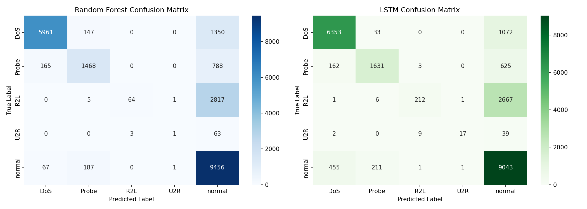
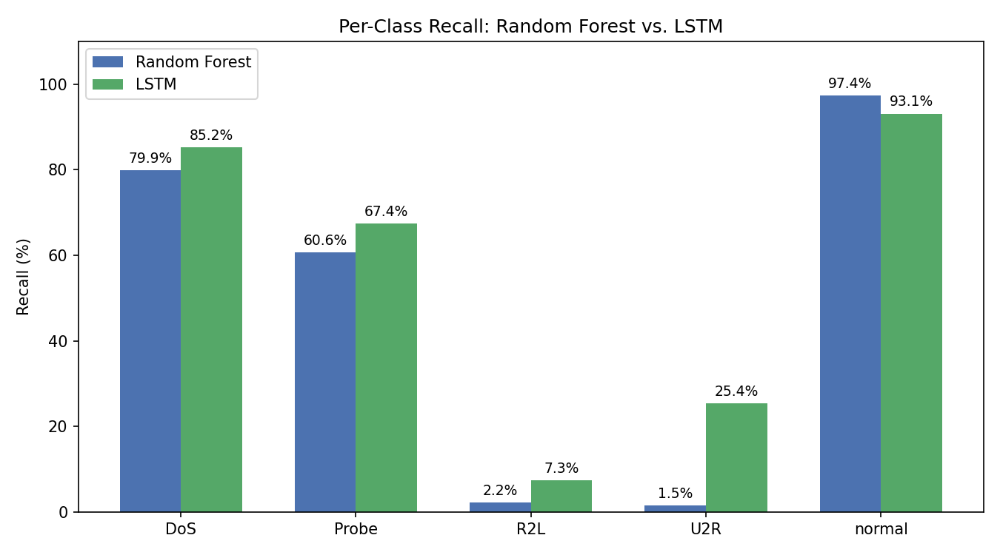
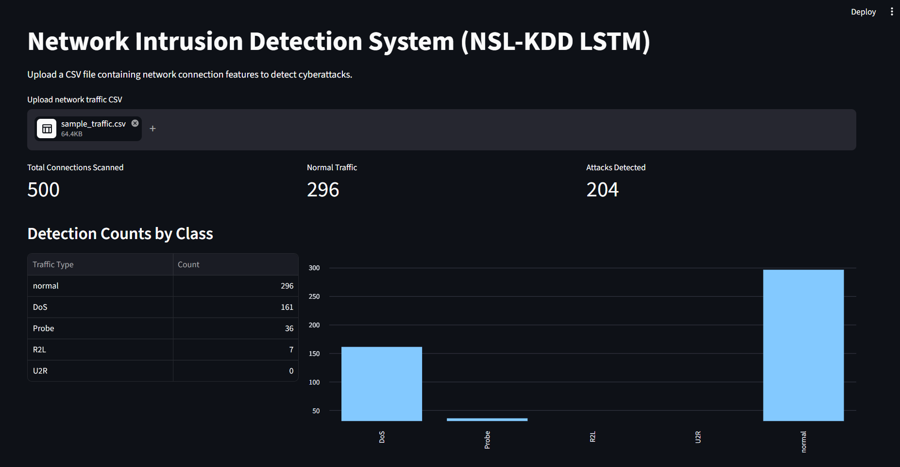
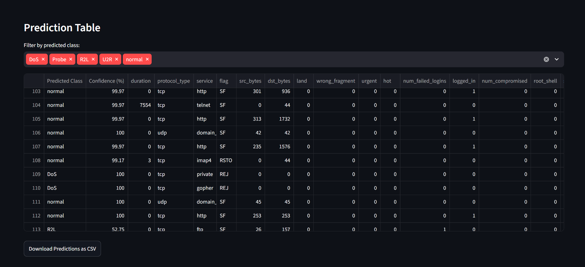

# Network Intrusion Detection System (NSL-KDD LSTM)

A deep learning–based Network Intrusion Detection System (NIDS) that classifies network connections into **normal traffic** or one of **four cyberattack categories** (`DoS`, `Probe`, `R2L`, `U2R`) using the NSL-KDD benchmark dataset, complete with an interactive **Streamlit** web application for batch CSV analysis.

---

## 1. Problem Statement

Modern networks handle thousands of connections per second, making manual threat monitoring impossible. Traditional signature-based firewalls struggle to detect novel or evolving attacks.

This project builds and evaluates a multi-class intrusion detection pipeline that:
1. Benchmarks a classical **Random Forest** baseline against a deep learning **LSTM (Long Short-Term Memory)** model on unseen test traffic containing zero-day attack subtypes.
2. Analyzes severe class imbalance and rare-attack detection performance (`R2L` and `U2R`).
3. Deploys the trained LSTM model in a **Streamlit** web dashboard where users can upload network traffic CSVs and inspect per-connection predictions and attack counts.

---

## 2. Dataset (NSL-KDD)

The **NSL-KDD** dataset is an improved version of the KDD'99 intrusion detection benchmark that removes duplicate records to prevent biased evaluation.

* **Training Set (`KDDTrain+`):** 125,973 connections
* **Test Set (`KDDTest+`):** 22,544 connections (includes 17 unseen attack subtypes not present in training)
* **Raw Input Features:** 41 features (38 numeric + 3 categorical: `protocol_type`, `service`, `flag`). The `difficulty` metadata column is dropped to prevent data leakage.
* **Processed Features:** 122 features after **One-Hot Encoding** the 3 categorical columns and applying **StandardScaler** to the 38 numeric columns (fit strictly on `KDDTrain+`, then applied to `KDDTest+`).

### Class Distribution

All 39 specific attack subtypes are grouped into 5 standard classes:

| Class | Description | Train Count | Train Share | Test Count |
|---|---|---:|---:|---:|
| **normal** | Benign network traffic | 67,343 | 53.46% | 9,711 |
| **DoS** | Denial of Service (flooding resources) | 45,927 | 36.46% | 7,458 |
| **Probe** | Surveillance and port scanning | 11,656 | 9.25% | 2,421 |
| **R2L** | Remote to Local (unauthorized remote access) | 995 | 0.79% | 2,887 |
| **U2R** | User to Root (privilege escalation) | 52 | 0.04% | 67 |
| **Total** | | **125,973** | **100.00%** | **22,544** |

---

## 3. Model Architecture

### Baseline: Random Forest
* `RandomForestClassifier(n_estimators=100, random_state=42)` trained on the 122 scaled/encoded features.

### Deep Learning Model: Keras LSTM
Each connection vector of 122 features is reshaped to 3D tensor format `(samples, 1, 122)` for sequence ingestion:

```text
Input Layer   : (None, 1, 122)
LSTM Layer    : 64 units                     (47,872 params)
Dropout Layer : rate = 0.3                   (0 params)
Output Layer  : Dense(5, activation=softmax) (325 params)
------------------------------------------------------------
Total Trainable Parameters: 48,197
```

* **Optimizer:** Adam
* **Loss Function:** `sparse_categorical_crossentropy`
* **Training Setup:** 20 epochs, batch size 128, 20% validation split, `EarlyStopping(monitor="val_loss", patience=4, restore_best_weights=True)`

---

## 4. Results (Random Forest vs. LSTM)

Evaluated on the official unseen `KDDTest+` set (22,544 samples):

### Overall Performance

| Metric | Random Forest (Baseline) | LSTM (Keras) | Difference |
|---|---:|---:|---:|
| **Accuracy** | 75.19% | **76.02%** | +0.83% |
| **Precision (Weighted)** | **0.8104** | 0.8059 | -0.0045 |
| **Recall (Weighted)** | 0.7519 | **0.7602** | +0.0083 |
| **F1-Score (Weighted)** | 0.7060 | **0.7238** | +0.0178 |
| **F1-Score (Macro)** | 0.4843 | **0.5749** | **+0.0906** |

### Per-Class Recall & F1-Score

| Class | Test Support | RF Recall | LSTM Recall | RF F1 | LSTM F1 |
|---|---:|---:|---:|---:|---:|
| **DoS** | 7,458 | 79.93% | **84.00%** | 0.8733 | **0.8741** |
| **Probe** | 2,421 | 60.64% | **64.68%** | 0.6944 | **0.7362** |
| **R2L** | 2,887 | 2.22% | **8.31%** | 0.0433 | **0.1530** |
| **U2R** | 67 | 1.49% | **20.90%** | 0.0286 | **0.3333** |
| **normal** | 9,711 | **97.37%** | 93.21% | **0.7820** | 0.7777 |

The LSTM outperforms the Random Forest baseline in overall accuracy, weighted F1, and especially **Macro F1 (+0.0906)**, achieving higher recall across every single attack category (~4× higher on R2L and ~14× higher on U2R).

### Confusion Matrices & Per-Class Recall





---

## 5. Streamlit Web Application

The interactive app (`app.py`) loads the saved `preprocessor.pkl`, `label_encoder.pkl`, and `lstm_model.keras` to classify uploaded traffic CSVs in batch.

### Features
* Drag-and-drop CSV upload with automatic validation of the 41 required features
* Top-level summary metrics (Total Scanned, Normal Traffic, Attacks Detected)
* Per-class attack count table and bar chart
* Filterable prediction table with confidence percentages and CSV export

### App Screenshots





---

## 6. How to Run Locally

```bash
# 1. Install dependencies
pip install -r requirements.txt

# 2. Launch the Streamlit app
python -m streamlit run app.py
```

Upload `sample_traffic.csv` in the browser to test predictions immediately.

---

## 7. Limitations & Future Work

* **Severe Class Imbalance (R2L & U2R):** `U2R` makes up only **0.04%** (52 rows) and `R2L` only **0.79%** (995 rows) of `KDDTrain+`. As shown in the confusion matrix, the LSTM still misclassifies **2,625 of 2,887** R2L rows and **45 of 67** U2R rows as `normal`.
* **Zero-Day Distribution Shift:** `KDDTest+` intentionally contains 17 attack subtypes never seen during training (heavily concentrated in R2L), capping supervised classification recall.
* **Single-Timestep Input:** Reshaping tabular rows to `(samples, 1, 122)` satisfies LSTM input requirements but does not exploit multi-packet temporal sequences.
* **Dataset Age:** NSL-KDD originates from 1999-era network traffic and does not reflect modern encrypted protocols (TLS 1.3, HTTP/3) or cloud attack vectors.

**Planned Improvements:**
1. Apply **class weights**, **Focal Loss**, or **SMOTE** oversampling (on training folds only) to boost rare-class recall.
2. Add an unsupervised **autoencoder anomaly detector** alongside the classifier to flag unseen zero-day traffic.
3. Evaluate on newer datasets such as **CIC-IDS2017** or **UNSW-NB15**.
